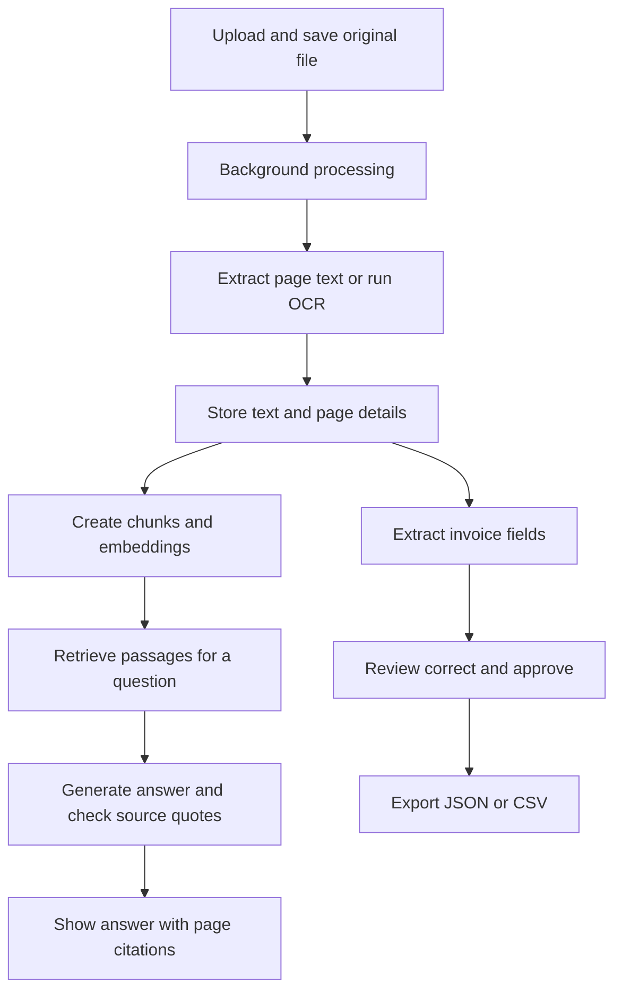

# Document Intelligence and Q&A

Upload documents, ask questions with page citations, and review extracted invoice data before exporting it as JSON or CSV.

## Run locally

Install **Python 3.11+**, [Ollama](https://ollama.com/download), and **Tesseract OCR**:

```sh
# macOS
brew install tesseract
# Ubuntu or Debian
sudo apt-get install tesseract-ocr tesseract-ocr-eng
```

From the project directory:

```sh
python3 -m venv venv
source venv/bin/activate
pip install -r requirements-dev.txt
# Create .env only if it does not already exist
test -f .env || cp .env.example .env
```

Start Ollama through its desktop app or `ollama serve`, then run:

```sh
ollama pull all-minilm       # Embedding model, about 45 MB
ollama pull llama3.2:3b      # Chat model, about 2 GB
python -m scripts.local_server
```

Open **http://127.0.0.1:8011**. Keep `LLM_PROVIDER=ollama` and `LLM_MODEL=llama3.2:3b` in `.env`. The local app uses SQLite and local vector search; no cloud account is needed. Files and reviews are saved in `storage/local-preview`.

## How to use it

1. **Add document** and wait for it to finish processing.
2. **Ask questions** and click a citation to open its supporting page.
3. **Review invoice** to check fields, correct mistakes, and approve the result.
4. Export the reviewed data as **JSON** or **CSV**.

Supports **PDFs, PNG, JPEG and UTF-8 text**, up to **10 MB and 50 pages** by default. PDFs can contain selectable text, scanned pages, or both.

## Architecture and data flow



**Stack:** FastAPI, PyMuPDF, Tesseract, Pydantic and Ollama. The local app uses `all-minilm` for embeddings and `llama3.2:3b` for answers. Invoice extraction and money validation run separately from chat.

## Tests and evaluation

```sh
python -m pytest -q
python -m evaluation.run --split held_out
```

See the [evaluation report](evaluation/REPORT.md), [chat checks](evaluation/CHAT_CHECK.md), and [schema guide](models/README.md) for details.

## Notes

- This is a **local single-user app**, with no authentication. Keep it on your own computer.
- OCR, invoice extraction and model answers can contain mistakes. Check important answers and invoice values against the original document.
- Use one server process. Interrupted jobs need to be uploaded again; back up `storage/local-preview` to retain your data.
- The alternative `main:app` entry point uses PostgreSQL, an existing Pinecone index and Redis on port 8000. Configure those services through [.env.example](.env.example) before running it. That deployment path remains unverified.
